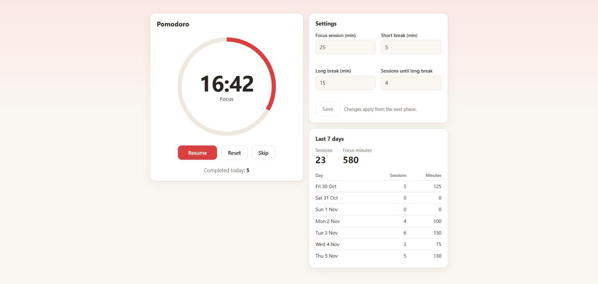
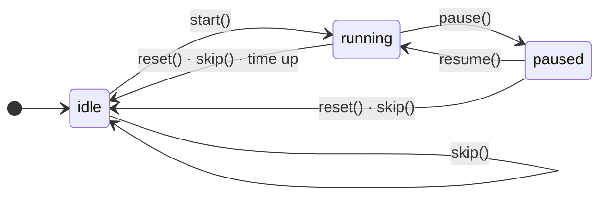

<div align="center">

# 🍅 Pomodoro

**A small Pomodoro timer built around an explicit state machine:<br>zoneless Angular 22 on the front, Fastify and SQLite behind it.**

<a href="#tech-stack"></a>

<br>



</div>

## Features

- ⏱️ **Focus, short break and long break** phases, with a long break after every N focus sessions
- 🎛️ **Start, Pause, Resume, Reset and Skip**, shown according to the timer state
- ⭕ **SVG progress ring** and the remaining time in the browser tab title, e.g. `12:34 · Focus`
- ⚙️ **Validated settings** that survive a page refresh and apply from the next phase
- 📊 **Statistics for the last 7 days**, grouped by day in your own time zone
- 🔌 **Works without the backend**: sessions that could not be saved are queued and sent later
- 🌙 **Dark mode** that follows the system setting

## Tech stack

| Skill | Where it shows in the project |
| --- | --- |
|  **Angular 22, standalone, zoneless** | The whole app, with no zone.js and no NgModule |
|  **Signals, `computed`, `effect`** | [Timer store](apps/web/src/app/pomodoro.store.ts), derived time and progress, tab title |
|  **State-driven UI** | Explicit timer state machine; the view only reads state |
|  **Signal Forms, validators** | [Settings panel](apps/web/src/app/settings.component.ts) with field and cross-field validation |
|  **`@defer`, lazy loading** | Stats panel loaded only after interaction |
|  **Resource API (`httpResource`)** | [Fetching statistics](apps/web/src/app/stats.component.ts) from the backend |
|  **Node.js, REST API** | [Fastify API](apps/api/src/app.ts) that stores completed sessions in SQLite |
|  **Jest** | Store tests with fake timers and API tests with `app.inject()` |
|  **Docker** | [Dockerfile](apps/api/Dockerfile) and Compose setup for the API |

## Getting started

Requires Node.js 22 or newer.

```bash
npm install
npm run dev
```

Open <http://localhost:4200>. The command starts the web app and the API (port 3000) together, and the Angular CLI proxy forwards `/api` to the API.

| Command | What it does |
| --- | --- |
| `npm run dev` | Starts both projects in parallel |
| `npm test` | Runs the tests of both projects |
| `npm run build` | Builds both projects |
| `docker compose up --build` | Runs only the API in Docker, with the database in a named volume |

The API reads `PORT` (default `3000`), `HOST` (default `localhost`) and `DB_PATH` (default `apps/api/data/pomodoro.db`).

## How the timer works

The state has two independent axes: a `status` and a `phase`.



- **Time running out and `skip()`** move to the next phase and return to `idle`, so you start every phase yourself.
- **`reset()`** returns to `idle` in the same phase, with the full time.
- **Only time running out on a focus session** increments the counter and saves the session.
- **A transition that is not allowed** in the current state does nothing.

## Design decisions

**Time is calculated from `endsAt`, not by counting ticks.** Browsers throttle intervals in background tabs, so subtracting a second per tick would make the timer drift. The store keeps the timestamp of the end of the phase and derives the remaining time from `endsAt - now`. The 250 ms interval only refreshes `now`, and it runs only while the timer is running.

**One store, thin components.** All transitions live in `PomodoroStore`. Components read signals and call methods, so the logic can be tested without rendering anything. The clock is injected through a `CLOCK` token, which lets tests move time directly.

**The timer never depends on the backend.** Each session goes through a queue in `localStorage` before it is sent. A failed request leaves it there, and it is retried on the next completed session or the next app start. If the server rejects a session outright, it is dropped so that it cannot block the ones behind it.

**Days are calculated per request, in the client's time zone.** Sessions are stored in UTC, and `?tz=Europe/Warsaw` decides which calendar day each one belongs to. A session at 23:30 UTC counts towards the next day in Warsaw.

**Install scripts are turned off.** Every native dependency ships prebuilt binaries, so the repo's `.npmrc` sets `ignore-scripts=true`. Otherwise npm tries to compile `better-sqlite3` from source, which fails on machines without a C++ toolchain, including slim Docker images.

## API

| Method | Path | Input | Response |
| --- | --- | --- | --- |
| `GET` | `/api/health` | | `200 { status: "ok" }` |
| `POST` | `/api/sessions` | `{ durationSec, completedAt }` | `201` with the saved session, `400` on invalid data |
| `GET` | `/api/sessions` | `?date=YYYY-MM-DD&tz=…` | `200` list of the sessions from that day |
| `GET` | `/api/stats` | `?days=7&tz=…` (1–30 days) | `200 [{ date, sessions, focusMinutes }]`, including days with zero |

`tz` defaults to UTC. Errors always have the form `{ error: string, details?: unknown }`.

## Project structure

```text
pomodoro/
├── apps/
│   ├── web/                Angular 22 app
│   │   └── src/app/        Store, sessions API and components
│   └── api/                Fastify API
│       ├── src/routes/     HTTP and JSON schemas
│       ├── src/repo/       SQL
│       └── test/           API tests
├── shared/types.ts         DTOs used by both projects
├── docker-compose.yml
└── SPEC.md                 Full specification
```

The full requirements are in [SPEC.md](SPEC.md).
